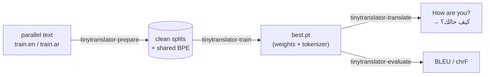

# tiny-translator

**A small, readable Transformer for machine translation: English → Arabic out of the box, any language pair by design.**

[](https://github.com/benisalla/tiny-translator/actions/workflows/tests.yml)
[](LICENSE)
[](pyproject.toml)
[](https://pytorch.org)

tiny-translator is the encoder-decoder Transformer from *Attention Is All You
Need*, written from scratch in plain PyTorch, plus everything around it that you
need to go from raw parallel text to translations:

- **data prep**: clean, de-duplicate and split any parallel corpus (your own files or a Hugging Face dataset);
- **a shared BPE tokenizer** trained on your data, which works with any script. Arabic stays in its natural order, with no reversal hacks;
- **training**: label smoothing, a warm-up learning-rate schedule, length-bucketed batches, gradient accumulation, resume, and self-contained checkpoints;
- **decoding**: batched greedy decoding and beam search with a length penalty;
- **evaluation**: BLEU and chrF (sacreBLEU), plus checkpoint averaging.



English and Arabic are only the defaults. Language codes are just file
suffixes, so `--src-lang fr --tgt-lang de` (or `en`/`zh`, `ar`/`en`...) works the
same way.

> **No pretrained weights are published.** You train the model on your own
> parallel data (see [docs/data.md](docs/data.md)). The built-in toy dataset
> lets you check the whole pipeline on a CPU.

## Quick start

```bash
# 1. install (Python >= 3.10)
python -m venv .venv && source .venv/bin/activate
pip install -e '.[dev,data]'              # see docs/training.md for GPU torch

# 2. check everything works (CPU, no network)
pytest

# 3. the whole pipeline on the built-in toy English -> Arabic set (CPU)
tinytranslator-prepare --toy --out-dir data/toy
tinytranslator-train --data-dir data/toy --preset tiny --max-steps 1500 --warmup-steps 200 \
    --eval-every 500 --tokens-per-batch 1000 --device cpu --output-dir checkpoints/toy
tinytranslator-translate --checkpoint checkpoints/toy/best.pt --text "three red bird"

# 4. real English -> Arabic data (OPUS-100, 1M pairs), then train on a GPU
tinytranslator-prepare --hf-dataset Helsinki-NLP/opus-100 --hf-config ar-en \
    --src-lang en --tgt-lang ar --out-dir data/en-ar
tinytranslator-train --data-dir data/en-ar --src-lang en --tgt-lang ar --output-dir checkpoints/en-ar

# 5. use and score it
tinytranslator-average checkpoints/en-ar/step_*.pt --output checkpoints/en-ar/averaged.pt
tinytranslator-translate --checkpoint checkpoints/en-ar/averaged.pt --input subtitles.en --output subtitles.ar
tinytranslator-evaluate --checkpoint checkpoints/en-ar/averaged.pt --beam-size 4
```

From Python:

```python
from tinytranslator import load_checkpoint, translate

model, tokenizer, _ = load_checkpoint("checkpoints/en-ar/best.pt")
print(translate(model, tokenizer, ["Good morning!", "See you tomorrow."], beam_size=4))
```

## Results on the toy dataset

Trained with the exact commands from the quick start (step 3): `--preset tiny`,
1,500 steps on CPU, 2,000 synthetic training pairs (a 16-word English lexicon
translated word by word into Arabic), scored on 100 unseen test pairs.

| Step | Train loss (label-smoothed) | Val loss | Val perplexity |
|------|-----------------------------|----------|----------------|
| 500  | 1.375 | 0.119 | 1.13 |
| 1000 | 0.959 | **0.092** | **1.10** |
| 1500 | 0.914 | 0.094 | 1.10 |

| Decoding | BLEU | chrF |
|----------|------|------|
| greedy (`--beam-size 1`) | **98.4** | **99.0** |
| beam search (`--beam-size 4`) | 95.1 | 95.9 |

```
$ tinytranslator-translate --checkpoint checkpoints/toy/best.pt \
      --text "three red bird" --text "blue cat" --text "seven green dog one"
ثلاثة أحمر طائر
أزرق قطة
سبعة أخضر كلب واحد
```

The model has 0.95M parameters here (155-token vocabulary). The run took
40 minutes wall-clock on a heavily shared 8-core CPU; an idle machine is much
faster. On the toy task beam search is slightly *below* greedy: the length
penalty is tuned for real sentences, and a word-by-word task leaves nothing for
the beam to find. These numbers show that the pipeline works end to end. They
say nothing about real translation quality, which depends on your data and
training budget (see [docs/data.md](docs/data.md#4-how-many-pairs-do-i-need)).

## Documentation

| Guide | What is inside |
|-------|----------------|
| [docs/data.md](docs/data.md) | Folder layout, `tinytranslator-prepare` (own files / Hugging Face / toy), cleaning rules, the tokenizer, how much data you need |
| [docs/training.md](docs/training.md) | CPU vs GPU, the overfit check, effective batch size, resume, what gets written, every flag, Python API |
| [docs/inference.md](docs/inference.md) | Translate sentences / files / pipes, beam vs greedy, BLEU and chrF evaluation |
| [docs/architecture.md](docs/architecture.md) | The model with tensor shapes: embeddings, masks, pre-norm blocks, loss, learning-rate schedule, beam search |
| [docs/testing.md](docs/testing.md) | Unit tests and what each one proves, the toy end-to-end run, the overfit check |

## Model sizes

| Preset | Layers (enc = dec) | Width | Heads | Params (16k vocab) | Good for |
|--------|--------------------|-------|-------|--------------------|----------|
| `--preset tiny` | 2 | 128 | 4 | 3.0M | CPU, toy data, smoke tests |
| `--n-embd 256 --n-heads 4 --n-layers 4` | 4 | 256 | 4 | 11.5M | one consumer GPU, ~1M pairs |
| `--preset base` (default) | 6 | 512 | 8 | 52.3M | the Transformer-base shape |

## Repository layout

```
src/tinytranslator/      the package (read in this order)
  config.py              every hyperparameter: ModelConfig, DataConfig, TrainConfig
  tokenizer.py           shared BPE tokenizer (any language, any script)
  data.py                parallel files -> length-bucketed padded batches; toy dataset
  model.py               the Transformer: attention, masks, encoder, decoder
  train.py               training loop + tinytranslator-train
  translate.py           greedy / beam search + tinytranslator-translate
  evaluate.py            BLEU / chrF + tinytranslator-evaluate
  average.py             checkpoint averaging + tinytranslator-average
  prepare.py             clean / split / tokenize a corpus + tinytranslator-prepare
  checkpoint.py          self-contained save / load
tests/                   43 tests, CPU only, no network (see docs/testing.md)
docs/                    the guides above
```

## Tests

```bash
pytest                      # 43 tests: model masks, tokenizer, batching, decoding, a real training run
ruff check src tests && ruff format --check src tests
```

The test suite trains a small model on the synthetic English → Arabic data and
checks that it translates more than 90% of unseen sentences exactly. It also
checks the properties that are easy to get subtly wrong: the decoder is causal,
padding has no effect on outputs, beam size 1 matches greedy decoding, and
resume and checkpoint averaging behave correctly.

## References

- Vaswani et al., 2017. *Attention Is All You Need*. [arXiv:1706.03762](https://arxiv.org/abs/1706.03762)
- Xiong et al., 2020. *On Layer Normalization in the Transformer Architecture* (pre-norm). [arXiv:2002.04745](https://arxiv.org/abs/2002.04745)
- Szegedy et al., 2016. *Rethinking the Inception Architecture* (label smoothing). [arXiv:1512.00567](https://arxiv.org/abs/1512.00567)
- Wu et al., 2016. *Google's Neural Machine Translation System* (beam length penalty). [arXiv:1609.08144](https://arxiv.org/abs/1609.08144)
- Sennrich et al., 2016. *Neural Machine Translation of Rare Words with Subword Units* (BPE). [arXiv:1508.07909](https://arxiv.org/abs/1508.07909)
- Tiedemann, 2012. *Parallel Data, Tools and Interfaces in OPUS*. [OPUS](https://opus.nlpl.eu/)

## License

[MIT](LICENSE)
