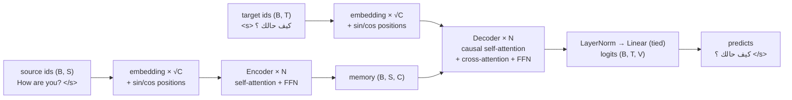

# Architecture

The model is the encoder-decoder Transformer from *Attention Is All You
Need* (Vaswani et al., 2017), written in ~150 lines of PyTorch in
[`model.py`](../src/en_2_ar_translator/model.py), with three modern defaults:
pre-norm residual blocks, a shared vocabulary with tied embeddings, and fused
scaled-dot-product attention.

Notation: B = batch, S = source length, T = target length, C = `n_embd`,
H = `n_heads`, D = C / H, V = `vocab_size`.



## 1. Embeddings

- One `nn.Embedding(V, C)` shared by the encoder input, the decoder input and
  the output projection (`lm_head.weight = embed.weight`). This is possible
  because the BPE vocabulary is shared by both languages, and it removes
  2 × V × C parameters (16.4M for the base model).
- Embeddings are scaled by √C and added to a fixed sinusoidal position table
  (`max_len × C`, a non-trainable buffer):
  `PE[p, 2i] = sin(p / 10000^(2i/C))`, `PE[p, 2i+1] = cos(p / 10000^(2i/C))`.

## 2. Attention

`MultiHeadAttention(x, kv, mask)`:

| Step | Shape |
|------|-------|
| `q = Wq x` split in H heads | (B, H, Tq, D) |
| `k, v = Wkv kv` split in H heads | (B, H, Tk, D) each |
| `softmax(q kᵀ / √D + mask) v` (PyTorch SDPA, fused kernel when available) | (B, H, Tq, D) |
| merge heads, `Wo` | (B, Tq, C) |

Two boolean masks (`True` = may attend):

- **source mask** (B, 1, 1, S): hides `<pad>` source tokens from every query.
- **target mask** (B, 1, T, T): `<pad>` keys hidden **and** lower-triangular,
  so position t only sees positions ≤ t. This is what makes the decoder
  autoregressive. Both properties are checked by
  `tests/test_model.py::test_decoder_is_causal` and
  `test_padding_does_not_change_results`.

## 3. Blocks (pre-norm)

```
EncoderLayer:  x = x + Drop(SelfAttn(LN(x)))
               x = x + Drop(FFN(LN(x)))

DecoderLayer:  x = x + Drop(CausalSelfAttn(LN(x)))
               x = x + Drop(CrossAttn(LN(x), memory))
               x = x + Drop(FFN(LN(x)))

FFN(x) = W2 · Drop(ReLU(W1 x)),  W1: C → 4C,  W2: 4C → C
```

A final LayerNorm closes each stack. Pre-norm (LayerNorm *inside* the residual
branch) keeps gradients well-scaled and makes training much less sensitive to
the warm-up length than the original post-norm layout.

## 4. Sizes

| Preset | n_embd | heads | layers (enc = dec) | params (16k vocab) | Use |
|--------|--------|-------|--------------------|--------------------|-----|
| `small` | 128 | 4 | 2 | ~3M | CPU, toy data, smoke tests |
| `base` | 512 | 8 | 6 | ~52M | real training on a GPU |

Any field can be overridden: `--n-embd 256 --n-heads 4 --n-layers 4` gives a
~11M model, a good middle ground for a single consumer GPU.

## 5. Training objective

Teacher forcing: the decoder reads `<s> y1 … yn` and is trained to output
`y1 … yn </s>` in one parallel pass. The loss is cross-entropy with
**label smoothing** (ε = 0.1: the target distribution puts 0.9 on the right
token and spreads 0.1 over the vocabulary), averaged over non-pad tokens.

Optimiser: Adam (β = 0.9 / 0.98, ε = 1e-9) with the "Noam" schedule

```
lr(step) = lr_scale · C^-0.5 · min(step^-0.5, step · warmup^-1.5)
```

linear warm-up for `warmup_steps`, then 1/√step decay. Gradients are clipped
at norm 1.0.

## 6. Decoding

[`translate.py`](../src/en_2_ar_translator/translate.py):

- **Greedy** (`--beam-size 1`): batched; at each step append the arg-max token,
  stop when every sentence has produced `</s>`.
- **Beam search** (default `--beam-size 4`): keeps the k best partial
  translations by summed log-probability; finished hypotheses are ranked by
  `score / ((5 + length) / 6)^α` (GNMT length penalty, α = 0.6) so the search
  does not favour overly short outputs.
- Generation stops at `min(2 × source length + 10, max_len - 1)` tokens.

## 7. Checkpoint averaging

`en2ar-average step_*.pt --output averaged.pt` averages the weights
of the last few evaluation checkpoints. This smooths out the noise of the last
optimiser steps and typically gives a small BLEU gain for free.
